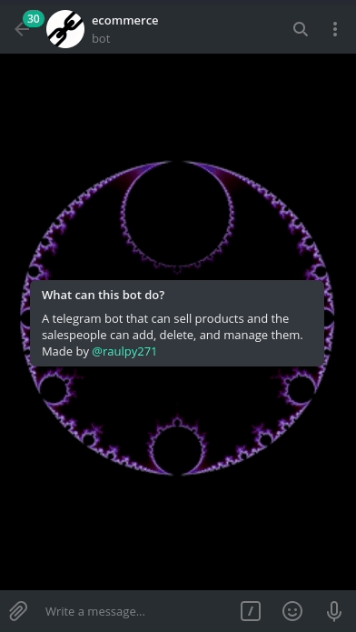
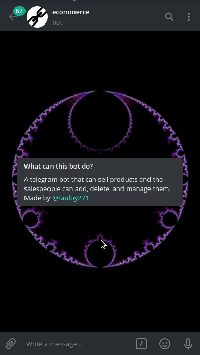
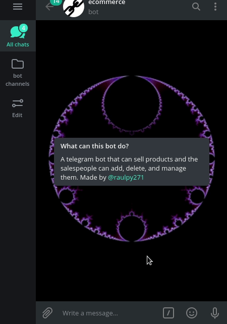
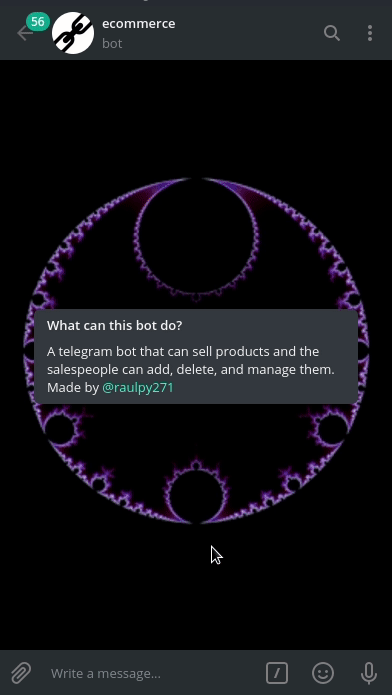

# 🤖 Telegram e-commerce

This is a Telegram bot made using Python and python-telegram-bot, with PostgreSQL for storage.
## 💖 All Contributors

<a href="https://github.com/raulpy271/telegram_ecommerce/graphs/contributors">
 
</a>

## 🛠️ TODO

- Add a feature to change password.
- Add salt when storing the password.
- Add support for other languages.
- Add password confirmation when a user buys a product.
- The handler that adds a product in the database doesn't check if the description of the product has more characters than the description column has.
- When the user selects the command \show_categories more than once, the bot only shows products one time.
- Add a filter to block non-admin commands like /add_product and /add_category.

## ❓What can this bot do ?

This is a Telegram bot where you can buy items.

Sellers can add, delete, and manage them.

The following are instructions on how to use this bot:

- Type /show_categories to see products by category.
- To search for something, you can use the command /search.
- To ask a catalog question in ordinary chat, configure `OPENAI_API_KEY`; the
  assistant can read categories and available products. See
  [catalog assistant setup](docs/catalog-assistant.md).
- To buy something, you need to register a password. To do this, type /register.
- The admins can add products and categories with the commands /add_product and /add_category.

## 🚸 Tutorial

### Register Command



### Seeing products



### Making a payment


### Searching for a product



### Changing the language



## ⚙️ How to set up ?

To setup the bot for testing and development is used Docker along with the command `docker compose`. This tool is recommended because it's more easy to setup the bot and it's database. However, if you don't want to use Docker you still can run the bot anyway, if it's your case after reading this topic you can jump to [Setup in local machine](#setup-in-local-machine).

To have a Telegram Bot, you need to open a chat with the Bot Father in Telegram, this bot will create a token that's needed to run your created bot. To make test payments, you should have a token from a payment provider as well. Learn more about payments on the [Telegram payment page](https://core.telegram.org/bots/payments). To learn more about Bot Token read [How Do I Create a Bot?](https://core.telegram.org/bots#how-do-i-create-a-bot).

The two tokens created need to be placed in the file `.env`, create this file using the template file `.env.example` which already comes with some settings filled. The created `.env` file is where you can change some settings and place private data as your tokens.
If `.env` already exists, edit it in place so an existing OpenAI key is preserved.

Set `ADMIN_USER_IDS` to a comma-separated list of Telegram numeric user IDs for accounts allowed to add products and categories. Usernames can change and are not used for this permission.

### Setup with Docker

First of all, install Docker Engine (or Docker Desktop, if you on Windows), [Install Docker Engine](https://docs.docker.com/engine/install/).

With docker installed, run the following commands to build the application and create the database schema needed:

```sh
# Build the application
docker compose build

# Start PostgreSQL and initialize the schema before starting the bot
docker compose up -d db
docker compose run --rm app alembic upgrade head

# Optional: add two clearly labeled demo products for local testing
docker compose run --rm app python -m telegram_ecommerce.database.seed_demo

# Start the bot and follow its logs
docker compose up -d app
docker compose logs -f app
```

For a local chat test, `BOT_TOKEN`, database settings, and `OPENAI_API_KEY` are
enough. Obtain the Telegram token from [@BotFather](https://t.me/BotFather) with
`/newbot`. After starting the app, open your bot in Telegram, send `/start`, then
ask "What does the Demo Notebook cost?". A payment-provider test token is needed
separately to exercise checkout. The database port binds to localhost only.

The database connection is already filled in the `.env.example`, this connection is to the database created in a docker container using the commands above.

### Setup in local machine

First of all, see the dependencies in the requirements file or type `pip3 install -r requirements.txt` to install the dependencies automatically.

In this method, set up PostgreSQL locally or with a hosting provider. Set `DB_HOST`, `DB_PORT`, `DB_NAME`, `DB_USER`, and `DB_PASSWORD` in `.env`. You can instead set `DATABASE_URL` to a `postgresql+psycopg://` URL; it takes precedence over the individual settings.

In a nearly created database you should create the schema(tables) used in the Bot, to do it use the alembic command below:

```sh
alembic upgrade head
```

The PostgreSQL migration creates checks for nonnegative prices and stock, preserves the bot's 0/5/10 rating values, and adds a full-text search index. Existing MySQL data is not transferred by Alembic: back up the MySQL database and export/import its rows into PostgreSQL before switching a deployed bot. `Numeric(12, 2)` prices round to cents, so check values and any invalid stock or rating data before import.

Finally, you can run the Bot in your machine:

```py
python3 bot.py
```

## 🛑 Disclaimer

This project is a demo, it's only for learning purposes. To be ready for production, many features need to be added.


